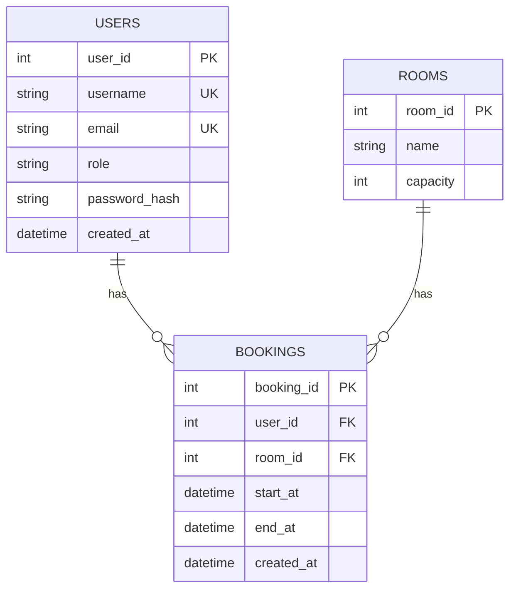

# Booking API

REST API for room booking built with FastAPI and PostgreSQL, with JWT authentication, role-based access and protection against overlapping bookings.

## Tech Stack

- Python 3.14
- FastAPI
- PostgreSQL 16
- SQLAlchemy 2.0
- Alembic
- Pydantic 2
- Psycopg 3
- PyJWT
- Argon2
- Pytest
- Docker
- Docker Compose

## Project Structure

```text
booking-api/
├── alembic/
│   └── versions/          # Database migrations
├── src/
│   └── app/
│       ├── routers/
│       │   ├── bookings.py
│       │   ├── rooms.py
│       │   └── users.py
│       ├── api.py
│       ├── database.py
│       ├── dependencies.py
│       ├── exceptions.py
│       ├── models.py
│       ├── schemas.py
│       ├── security.py
│       └── service.py
├── tests/
│   ├── api/
│   ├── database/
│   ├── integration/
│   ├── security/
│   ├── service/
│   └── conftest.py
├── .env.example
├── alembic.ini
├── compose.yaml
├── Dockerfile
└── requirements.txt
```

## Database schema



## Quick Start

Clone the repository:

```bash
git clone https://github.com/herdlich/booking-api.git
cd booking-api
```

Create the environment file:

```bash
cp .env.example .env
```

Generate a JWT secret and add it to `.env`:

```bash
openssl rand -hex 32
```

Build the API image and start PostgreSQL:

```bash
docker compose build
docker compose up -d db
```

Apply database migrations:

```bash
docker compose run --rm api alembic upgrade head
```

Start the API:

```bash
docker compose up -d api
```

The API is available at:

```text
http://localhost:8000
```

## Swagger UI

Interactive API documentation:

```text
http://localhost:8000/docs
```

OpenAPI schema:

```text
http://localhost:8000/openapi.json
```

## Tests

The test suite uses separate PostgreSQL databases configured through:

```env
DATABASE_TEST_URL
DATABASE_MIGRATION_TEST_URL
```

With the default `.env.example` values, create the test databases:

```bash
docker compose exec db psql -U user -d postgres -c "CREATE DATABASE test_db_name;"
docker compose exec db psql -U user -d postgres -c "CREATE DATABASE migration_test_db_name;"
```

Run the test suite:

```bash
docker compose run --rm api pytest
```